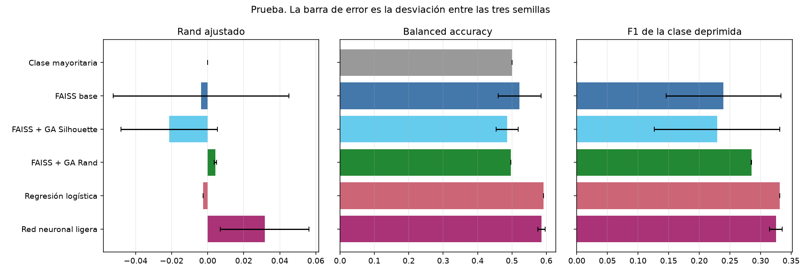
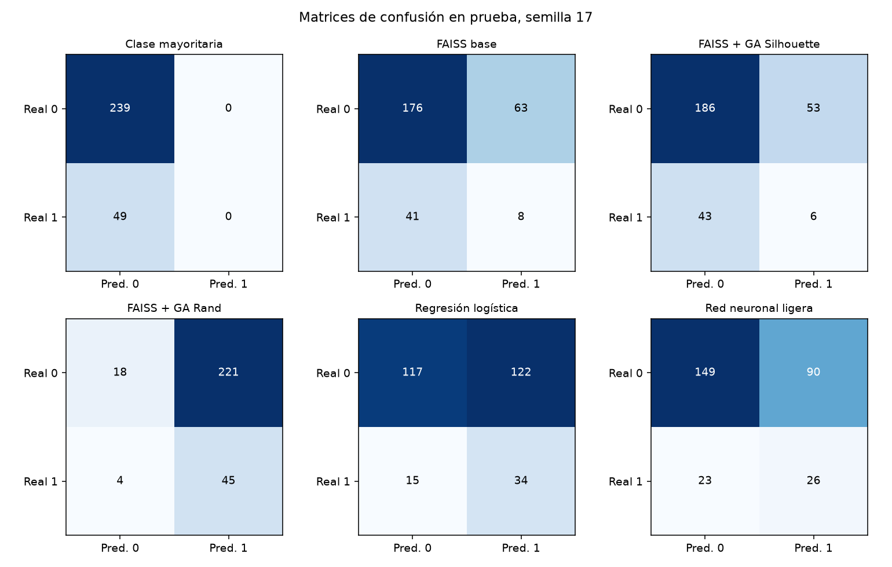
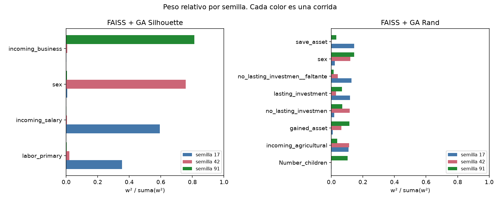
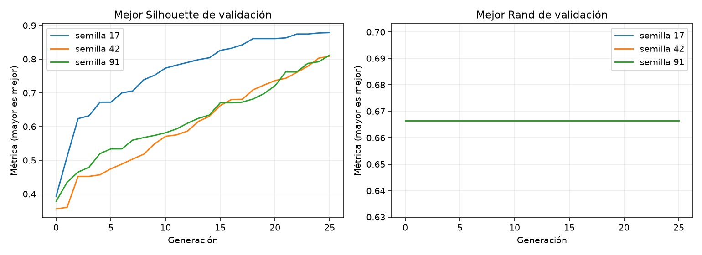

# Cuaderno FAISS y genético — resultados

Lectura del protocolo de `depresion_faiss_genetico.ipynb`, que ahora es el código de `src/plena`. Se corre con `scripts/run.py`. El estudio anterior, con otra partición y otro `k`, queda descrito en `PLENA_Estado_Resultados.md`.

PLENA no diagnostica depresión. `depressed` es el indicador binario del CSV. Cómo se construyó no está documentado.

## Pregunta

¿Una ponderación de variables, buscada por un genético, mejora un agrupamiento de dos grupos y su coincidencia con `depressed`?

Se compara FAISS sin ponderar, FAISS con un genético de Silhouette, FAISS con un genético de Rand, y tres baselines: clase mayoritaria, regresión logística y una red neuronal ligera.

## Protocolo

Datos: `data/b_depressed.csv`, 1 429 filas, 238 positivos (16.7 %). El hash SHA-256 coincide con la copia del cuaderno. Se quitan `Survey_id` y `Ville_id`. Quedan 20 variables. Los 20 faltantes de `no_lasting_investmen` se imputan con la mediana de train y se agrega un indicador de ausencia: la matriz tiene 21 columnas. Después se estandariza con media y desviación de train. No hay `log1p`.

Partición estratificada por etiqueta, semilla 2026, 60/20/20. Train 856 (142 positivos), validación 285 (47), prueba 288 (49). Las tres semillas del algoritmo comparten a las mismas personas. La desviación mide variabilidad del algoritmo, no un intervalo sobre otras muestras.

FAISS aprende dos centroides en train y asigna cada punto nuevo al centro más cercano. El cromosoma es un peso por variable en [−1, 1]. La distancia usa el cuadrado del peso, así que el signo no indica una relación con la etiqueta. Cada cromosoma se normaliza por su máximo absoluto. El genético tiene población 20, 25 generaciones, cruce aritmético, mutación gaussiana y dos elites. La población inicial incluye un individuo de pesos iguales.

Hay dos búsquedas, y las dos puntúan en validación:

- Silhouette, en el espacio ponderado. La etiqueta no entra en esa aptitud.
- Rand Index contra `depressed` en validación. Esa búsqueda sí usa la etiqueta.

La correspondencia cluster → clase se elige solo con train, por balanced accuracy. El umbral de la logística y de la red también se elige en validación. La prueba se lee después, una vez. La logística se ajusta una sola vez; por eso su desviación entre semillas es cero.

## Resultados de prueba

Media ± desviación entre las semillas 17, 42 y 91. Fuente: `results/cuaderno/resumen.csv`.

| Método | Rand | ARI | Balanced accuracy | F1 | ROC-AUC |
|---|---:|---:|---:|---:|---:|
| Clase mayoritaria | 0.717 | 0.000 | 0.500 | 0.000 | 0.500 |
| FAISS base | 0.541 ± 0.040 | −0.004 ± 0.049 | 0.522 ± 0.063 | 0.240 ± 0.094 | 0.522 |
| FAISS + GA Silhouette | 0.604 ± 0.045 | −0.021 ± 0.027 | 0.486 ± 0.032 | 0.229 ± 0.102 | 0.486 |
| FAISS + GA Rand | 0.647 ± 0.009 | 0.004 ± 0.001 | 0.497 ± 0.000 | 0.285 ± 0.001 | 0.497 |
| Regresión logística | 0.499 | −0.003 | 0.592 | 0.332 | 0.623 |
| Red neuronal ligera | 0.524 ± 0.022 | 0.032 ± 0.025 | 0.586 ± 0.011 | 0.325 ± 0.010 | 0.591 |

El Silhouette del GA en su espacio ponderado es 0.823 ± 0.030. El mismo agrupamiento, medido en el espacio estandarizado sin pesos, queda en 0.165 ± 0.021. FAISS base, en ese espacio común, queda en 0.157 ± 0.017.



La clase mayoritaria acierta el 83.0 % de las filas porque predice siempre «no». Su Rand es el más alto de la tabla y su ARI es cero: con una clase del 16.7 %, casi todos los pares son dos personas sin la etiqueta. El ARI, la balanced accuracy y el F1 son las columnas que leen la coincidencia con `depressed`.

## Matrices de confusión

Prueba: 239 negativos y 49 positivos. La figura es la semilla 17, fijada de antemano. La tabla trae las tres semillas porque el mapeo de los clusters cambia de corrida en corrida.



| Método | Semilla | TN | FP | FN | TP |
|---|---:|---:|---:|---:|---:|
| Clase mayoritaria | 17, 42, 91 | 239 | 0 | 49 | 0 |
| FAISS base | 17 | 176 | 63 | 41 | 8 |
| FAISS base | 42 | 93 | 146 | 13 | 36 |
| FAISS base | 91 | 187 | 52 | 33 | 16 |
| FAISS + GA Silhouette | 17 | 186 | 53 | 43 | 6 |
| FAISS + GA Silhouette | 42 | 23 | 216 | 5 | 44 |
| FAISS + GA Silhouette | 91 | 30 | 209 | 5 | 44 |
| FAISS + GA Rand | 17 | 18 | 221 | 4 | 45 |
| FAISS + GA Rand | 42 | 23 | 216 | 5 | 44 |
| FAISS + GA Rand | 91 | 23 | 216 | 5 | 44 |
| Regresión logística | 17, 42, 91 | 117 | 122 | 15 | 34 |
| Red neuronal ligera | 17 | 149 | 90 | 23 | 26 |
| Red neuronal ligera | 42 | 128 | 111 | 18 | 31 |
| Red neuronal ligera | 91 | 164 | 75 | 24 | 25 |

El GA de Silhouette, en la semilla 17, marca depresión en 6 de 49 positivos. En las semillas 42 y 91 marca depresión en casi toda la prueba. Las dos conductas tienen balanced accuracy junto a 0.5. El GA de Rand marca depresión en más de 200 de las 239 personas sin la etiqueta y recupera unos 44 de los 49 positivos: recall alto, precisión 0.169, balanced accuracy 0.497.

La logística recupera 34 de 49 positivos y marca 122 negativos. Su umbral de validación es 0.155, con L2 = 0.1. La red queda en el mismo rango, con variación entre semillas.

## Qué pondera el genético

La participación de una variable es `w² / suma(w²)`.



En Silhouette cada semilla se concentra en una variable distinta:

| Semilla | Variables que concentran el peso | Participación |
|---|---|---:|
| 17 | `incoming_salary`, `labor_primary` | 0.594 y 0.354 |
| 42 | `sex` | 0.758 |
| 91 | `incoming_business` | 0.812 |

No hay un vector de pesos compartido. Promediar las tres corridas mezcla tres soluciones de una sola variable.

En Rand ninguna variable pasa de 0.15. El peso queda repartido y el ranking cambia con la semilla.



El Silhouette de validación sube a lo largo de las 25 generaciones, hasta 0.81–0.88. El Rand de validación entra en 0.666 en la población inicial y las tres semillas se quedan ahí. Con este presupuesto, la búsqueda de Rand no mejora la solución que ya traía la primera generación.

## Lectura

- El genético de Silhouette separa su propio espacio. Esa separación no se sostiene en el espacio sin pesos, y la coincidencia con `depressed` queda por debajo de la clase mayoritaria en balanced accuracy.
- El genético de Rand sube el Rand de prueba frente a FAISS base (de 0.541 a 0.647). El ARI se mantiene en 0.004. La matriz muestra por qué: predice depresión en casi todas las filas.
- La logística es el baseline que mejor ordena la etiqueta: balanced accuracy 0.592, F1 0.332, ROC-AUC 0.623. La red queda al lado (0.586, 0.325, 0.591). Las dos usan la etiqueta de train. El agrupamiento no las alcanza.
- La clase mayoritaria fija el piso: accuracy 0.830, balanced accuracy 0.500, F1 0, ARI 0.

Una sola partición y tres semillas no establecen una diferencia estadística. El genético consulta la validación en cada evaluación, así que la cifra externa es la de prueba. La ponderación no se lee como causa ni como importancia clínica.

## Cómo repetirlo

Desde la raíz del repositorio. La red pide PyTorch (`torch==2.14.1`, rueda CPU):

```powershell
.\.venv\Scripts\python.exe -m pip install -e ".[dev]"
.\.venv\Scripts\python.exe -m pip install torch==2.14.1 --index-url https://download.pytorch.org/whl/cpu
.\.venv\Scripts\python.exe scripts\run.py
```

La corrida de esta máquina tardó unos 20 segundos. Escribe `results/cuaderno/resumen.csv`, `metricas_prueba.csv`, `matrices_confusion.csv`, `pesos.csv` y las figuras de este documento.
